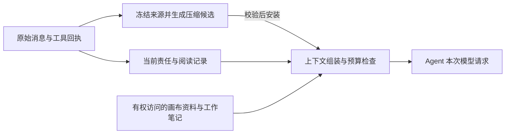

# 上下文管理与压缩改进方案

状态：总体设计；2026 年 10 月 15 日已实现其中的通用摘要、独立工作状态、阅读记录和资料召回。基线：v0.5.3，提交 `95240c5`。实验结果、落地范围与未实现项见[实验报告](../experiments/context-compression-2026-10-15.md)。下文原生压缩、后台候选、恢复上下文重建及团队规模试验仍属于后续设计。

Intrica 应把任务要求、消息责任、工具执行状态和阅读位置保存在持久记录中，由服务端在每次模型请求前重新组装。模型摘要负责保存解释、判断和接续线索。画布负责组织可共享的资料与成果，每名 Agent 按职责和权限取得自己的工作上下文。

优先实施完整旧摘要保留、压缩契约简化、阅读进度记录和历史召回，再接入提供者原生压缩及后台压缩。继续复用现有数据库、运行租约、消息投递、审批、工具回执和模型调度器。

## 调研范围与版本

本方案核对官方文档、公开源码和下列发布标签。主干中的实验功能单独说明；这些机制的比较不构成统一基准下的性能排名。

| Harness | 已检查发布标签 | 固定的主干源码 | 发布与主干差异 |
| --- | --- | --- | --- |
| Codex | `rust-v0.162.1`，`092d3acd` | [`78dc2503`](https://github.com/openai/codex/tree/78dc2503840d05f4411ae184bb5560ef327fce3c) | 发布版已有远程压缩 V2；主干增加后台候选与安装流程，`async_compaction` 仍为开发中、默认关闭 |
| Pi | `v1.2.0`，`06a46693` | [`6374c2ba`](https://github.com/earendil-works/pi/tree/6374c2baf432419ccb4541a99ce4958ecd03dae0) | 本次核对的核心 `compaction.ts` 与发布标签相同 |
| Kimi Code | `@moonshot-ai/kimi-code@2.1.1`，`f67e6398` | [`f28c51c0`](https://github.com/MoonshotAI/kimi-code/tree/f28c51c01f025bba9f0d0f58f6309e7517a8cd02) | 核心全量压缩服务相同，真实用户输入的保留辅助逻辑有后续调整 |

旧 `MoonshotAI/kimi-cli` 已归档，官方要求迁移到 `MoonshotAI/kimi-code`。本方案研究新实现，不用旧 Python 版的压缩参数代表当前 Kimi Code。[迁移公告](https://github.com/MoonshotAI/kimi-cli/issues/2661)

## 三种实现的可借鉴机制

### Codex

Codex 按提供者能力选择远程压缩或本地摘要。当前远程 V2 通过 Responses 流发送 `compaction_trigger`，检查完整结束事件与唯一压缩项，再安装新上下文；保留输入有独立预算，受审版本为 64,000 tokens。这个预算不是通用的自动触发阈值，也不是保留所有近期工具结果的承诺。[请求与结果处理](https://github.com/openai/codex/blob/78dc2503840d05f4411ae184bb5560ef327fce3c/codex-rs/core/src/compact_remote_v2.rs) · [提供者分流](https://github.com/openai/codex/blob/78dc2503840d05f4411ae184bb5560ef327fce3c/codex-rs/core/src/tasks/compact.rs)

自动压缩同时考虑配置的增长阈值和完整窗口硬上限。官方配置支持按全部上下文，或本轮压缩后固定前缀之外的增长计量。背景状态较大时，后一种计量能避免刚压缩完就因固定前缀再次触发，但完整窗口上限仍然有效。[配置说明](https://learn.chatgpt.com/docs/config-file/config-reference) · [窗口计量](https://github.com/openai/codex/blob/78dc2503840d05f4411ae184bb5560ef327fce3c/codex-rs/core/src/session/context_window.rs)

主干的后台压缩冻结历史前缀，核对历史代际、模型和身份后才采用结果；前缀替换保留期间追加的历史。候选无效或安装后仍超预算时，可转前台压缩。该功能仍默认关闭，适合作为第二阶段的并发设计参考。[后台候选](https://github.com/openai/codex/blob/78dc2503840d05f4411ae184bb5560ef327fce3c/codex-rs/core/src/session/async_compaction.rs) · [安装与回退](https://github.com/openai/codex/blob/78dc2503840d05f4411ae184bb5560ef327fce3c/codex-rs/core/src/compact_remote_v2_installation.rs) · [功能状态](https://github.com/openai/codex/blob/78dc2503840d05f4411ae184bb5560ef327fce3c/codex-rs/features/src/lib.rs)

对 Intrica 接入 OpenAI 公共 API，优先遵循公开的 `/responses/compact` 契约：返回窗口可能包含保留消息和不透明压缩项，应整体传递。内联 `context_management` 则有自己的输入链管理规则。两者不能混用同一套裁剪逻辑；不能把原生压缩项转成文字摘要或推断其可跨提供者使用。[官方压缩指南](https://developers.openai.com/api/docs/guides/compaction)

### Pi

Pi 默认在 `contextTokens > contextWindow - 16384` 时压缩，近期保留预算默认为 20,000 tokens。它按合法消息边界切分，工具结果跟随原调用；上一份摘要作为独立 `previousSummary` 输入，增量历史另行传入。一次用户请求跨度过长时，可以分别总结早期历史与当前请求前半段。[压缩算法](https://github.com/earendil-works/pi/blob/6374c2baf432419ccb4541a99ce4958ecd03dae0/packages/coding-agent/src/core/compaction/compaction.ts)

压缩在原会话日志中追加记录，保存 `firstKeptEntryId`，后续请求由摘要与保留范围重建。原记录仍可用于历史检索。文件操作名单独累计，并由程序追加到摘要；因此它不完全依赖摘要模型记住读写过的路径。[会话与压缩说明](https://pi.dev/docs/latest/compaction)

Pi 的摘要输入会把工具结果缩短到 2,000 字符，同时排除 thinking；这个规则不作用于独立传入的 `previousSummary`。其文件名单主要来自调用参数，不能证明文件完整读完、调用成功或模型理解了内容。Intrica 应借鉴独立文件记录，并进一步绑定成功回执、版本和范围；不照搬工具正文的统一截断来支撑完整项目阅读。[序列化与文件跟踪](https://github.com/earendil-works/pi/blob/6374c2baf432419ccb4541a99ce4958ecd03dae0/packages/coding-agent/src/core/compaction/utils.ts)

### Kimi Code

当前策略默认在窗口使用量达到 85%，或距离上限不足 50,000 tokens 时触发，较小窗口会避开无效预留值。计量支持提供者实测与新增内容估算结合。[触发策略](https://github.com/MoonshotAI/kimi-code/blob/f28c51c01f025bba9f0d0f58f6309e7517a8cd02/packages/agent-core-v2/src/agent/fullCompaction/strategy.ts) · [计量配置](https://github.com/MoonshotAI/kimi-code/blob/f28c51c01f025bba9f0d0f58f6309e7517a8cd02/packages/agent-core-v2/src/agent/tokenCounting/configSection.ts)

实际全量压缩入口处理冻结的完整历史，生成自由文本交接摘要，随后从独立服务重新附加 TODO，并附上事件日志的恢复路径与行号范围。安装时保留受预算约束的真实用户输入，加入摘要和继续任务提示。用户输入的保留上限为 20,000 tokens，其中长历史可保留约 2,000 tokens 的最早输入及近期输入。实现中的旧尾部策略不能代替对当前调用入口的核对。[压缩服务](https://github.com/MoonshotAI/kimi-code/blob/f28c51c01f025bba9f0d0f58f6309e7517a8cd02/packages/agent-core-v2/src/agent/fullCompaction/fullCompactionService.ts) · [上下文组装](https://github.com/MoonshotAI/kimi-code/blob/f28c51c01f025bba9f0d0f58f6309e7517a8cd02/packages/agent-core-v2/src/agent/contextMemory/compactionHandoff.ts)

Kimi Code 区分输出截断、空响应、上下文溢出和暂时性请求失败；溢出恢复会缩小输入，记录省略数量，并保留历史恢复入口。其大工具结果也支持保存正文、返回预览和路径，并说明实际保存范围。[恢复入口](https://github.com/MoonshotAI/kimi-code/blob/f28c51c01f025bba9f0d0f58f6309e7517a8cd02/packages/agent-core-v2/src/agent/fullCompaction/contextRecovery.ts) · [工具结果保存](https://github.com/MoonshotAI/kimi-code/blob/f28c51c01f025bba9f0d0f58f6309e7517a8cd02/packages/agent-core-v2/src/agent/toolResultTruncation/toolResultTruncationService.ts)

Intrica 采用 TODO 独立重挂载和历史召回的思路。真实指令继续独立保护；现有摘要使用 assistant 背景标记的约束保留。Kimi 的合成 user 摘要、用户输入截断和删除旧来源恢复方式，不适合作为 Intrica 的直接替换实现。

## 当前实现必须解决的问题

2026 年 10 月 14 日本地新画布的只读复核确认：35 次旧摘要进入后继压缩，其中 29 次被首尾截断；一次删除了中间 8,075 个字符，包括完整的 4 条已完成事项和 4 条未完成事项。来源哈希与离线复现相同。3 次运行因摘要连续校验失败而终止，但失败响应和具体校验项未保存，无法还原每次拒绝的细分原因。

当前 `sourceMessages` 把旧摘要与普通 assistant 输出同样截短；`SummarySchema` 和提示词的数组项数、条目长度、总长度要求不同；调度器对校验失败重复相同请求。阅读游标存在，但没有独立的文件范围进度。以上问题分别在来源保留、协议、恢复和任务状态层处理。

## 状态分层与画布职责

| 层次 | 内容及来源 | 生命周期 | 进入模型上下文的方式 |
| --- | --- | --- | --- |
| 原始记录 | 用户原文、委派、协作消息、工具调用与实际结果、审批事件 | 按现有数据保留策略保存，压缩不删除 | 近期原文及可检索引用 |
| 当前执行事实 | 权限、未读与待回复项、待执行工具、未知效果、实际交付和复核结果 | 复用现有业务记录，按当前版本查询 | 每次请求生成精简状态；必需项不经摘要改写 |
| 阅读与验证记录 | 资源版本、成功读取范围、返回范围、续读位置、验证调用 | 独立持久化，可由工具回执重建 | 当前资源的进度与证据索引 |
| 工作笔记 | 解释、判断、已解决问题、待核实假设和接续计划 | 带来源的模型产物，可修订、归档 | 按任务相关性检索；始终标记为模型生成 |
| 模型工作上下文 | 有效要求、当前事实、笔记、近期完整交互、提供者续接状态 | 每次请求重新组装，支持版本替换 | 由模型适配器生成原生请求 |

原始记录与执行事实继续由 PostgreSQL 和现有模块负责，不建立第二套权限、消息或工具状态库。现有 `context_summaries` 演进为压缩版本记录，保留前一有效版本。模型摘要中的“已经完成”不会修改任务、投递或工具状态。

画布提供三种不同作用：

1. 用户选择、明确链接、任务关联和资源归属帮助决定相关性。节点距离、颜色、分组和视觉邻近不授予权限。
2. 文件、网页、PDF、图片、报告及 todo 节点提供稳定资源身份。笔记引用节点版本、附件哈希、页码、行段或截图快照；资源变化后，旧结论标记为待重查。
3. 管理者获得成员的职责、实际状态、结果摘要及可访问证据。成员获得自己的任务、相关资源与协作请求。完整成员历史只在确有需要且有权访问时检索。

工作笔记默认保存在所属 Agent 的会话范围，显示在详情页，不自动铺满画布。经过现有分享与访问规则后，可整理成画布资料节点。读取角色的 Agent 可以由运行时自动保存阅读进度；这项内部记录不赋予它修改用户文件或共享节点的权限。

共享笔记继承来源可见范围，向更广范围分享需要走现有授权路径。摘要、原生压缩项和检索索引都属于派生资料；恢复与模型切换时重新检查访问范围。撤权导致现有上下文包含已失去权限的资料时，必须用当前允许的来源重建，不能只过滤后续检索结果。

## 每次请求的上下文构造

服务端统一执行以下步骤：

1. 取得当前运行 epoch、有效用户要求及委派、权限、工具目录和资源版本。
2. 在执行安全边界接收新输入、已完成工具和协作回执。未完成调用保持原身份与结果状态。
3. 组装有效要求原文、当前责任、相关工作笔记、近期完整交互，再按提供者协议加入续接状态。
4. 计算完整请求预算，包括系统提示、工具 schema、媒体和输出预留；选择继续、轻量整理或压缩。
5. 发送请求并记录其实际输入边界。结束或等待仍使用现有 `review_progress`。

根请求和仍有效的后续修正保持来源与顺序。阶段交付不自动消除原要求；范围变化只能依据实际用户输入或有权管理者的委派。资料正文通过资源引用分页，不与指令混为一类。有效要求本身确实超出可用窗口时，返回具体阻塞原因及来源范围，不静默删掉中间要求。

消息“加入 checkpoint”“进入主模型请求”和“已回复或已处理”分别记录。压缩器读到协作消息不代表执行 Agent 已处理。UI 已读以进入有效主模型请求为边界；完成由交付与复核决定。新报告在压缩期间到达时排入追加区，不能被旧候选覆盖或直接标为已处理。

## 先控制输入增长，再进行有损压缩

每个工具提供独立的模型输出投影。数据库保存实际回执，模型收到有界正文及稳定证据引用。重复不变的工具 schema、历史进度通知和已经保存的大段日志可从工作上下文移出，完整记录仍可召回。

文件读取返回资源版本、实际范围、是否结束和续读位置。搜索结果说明搜索范围、截断和跳过项，搜索命中不能记为文件读完。命令输出保存可恢复正文并声明保存范围；保存失败时不得声称可恢复。PDF、图片、浏览器页面引用实际快照，不把旧截图描述当作当前状态。

同一批工具的总体输出受当前剩余预算约束。单个巨大结果通过分页或外部正文引用返回，不能依靠下一轮模型摘要解决已经超出窗口的响应。原始调用与结果的协议配对保持完整。

阅读记录至少区分“工具返回了这些内容”“这些内容进入了模型请求”和“模型声称完成了分析”。只有前两项能由服务端机械证明；完整理解不能由读取次数或百分比推导。

对于同版本、同范围的重复读取，返回上次读取位置和已有笔记提示，允许必要复查。不得简单缓存后拒绝重新阅读，也不解析任意 Bash 文本来虚构已读覆盖率。完整阅读任务可基于文件清单显示覆盖情况，初始清单版本、排除规则和文件变化必须可追溯。

## 压缩后端与摘要契约

统一 `CompactionBackend`，提供两种实现，复用一个计划、调度和提交流程。

| 后端 | 适用范围 | 输出 | 限制 |
| --- | --- | --- | --- |
| 原生压缩 | 已声明且经过契约测试的端点与模型 | 提供者规定的完整压缩窗口及不透明状态 | 按原协议保存和传递；绑定提供者、模型能力与格式版本 |
| 通用摘要 | 其他模型，或原生状态不能继续使用时 | 有界的交接摘要与服务端来源清单 | 原摘要完整作为独立输入；原始记录和工作进度仍可召回 |

不根据模型名字或“兼容 OpenAI”推断原生压缩能力。端点能力通过配置和受控探测确定。模型切换时只复用明确兼容的原生状态；否则从已授权的原始记录、便携笔记和执行事实重建。原生状态不承担画布共享知识的职责。

通用后端采用轻量文本交接格式，描述已确定结论、依据、未确定问题和下一步。删除当前必须返回四个 JSON 数组及复制全部来源标签的要求。结构化输出可靠的端点可以返回单个 `summary` 字段；其他端点使用文本，解析集中在适配器中。

服务端生成会话身份、来源区间、哈希、父压缩版本、模型请求和候选版本。来源标签使用跨轮稳定的证据引用，避免每轮重用 `s1` 后产生歧义。模型可以在结论中引用证据，但来源清单由服务端确定，不要求模型回抄。

硬校验仅检查完整结束、非空有效正文、预算、协议配对、来源身份和版本；引用的证据必须可解析且属于本次可用范围。空承诺、工具调用式响应及截断输出不能作为交接摘要安装。语义完整性通过独立执行事实、可召回资料及评测约束，不能宣称文本格式校验足以证明摘要正确。

较长任务按已完成的工作段或资源主题保存带来源笔记。压缩输入为完整的上一有效交接摘要、需要更新的笔记与新增历史；过大时按来源边界分批处理。每个批次都有来源范围与恢复引用。对当前无关的旧知识保留索引并按需检索，不把所有资料反复重写成一份不断增长的摘要。

整个 JSON 文本或旧摘要不得按首尾字符裁切。预算不足时减少摘要覆盖范围、分批总结，或保留完整旧摘要并推迟更新。上一份已验证候选始终可用于恢复。

## 预算与触发

预算统一按实际发送的表示计算。提供者上一次输入用量只适用于相同上下文代际和投影；压缩或切换表示后重新估算，下一次有效响应再校准。缓存命中的 token 仍占上下文；不透明状态使用提供者用量或能力定义计量，不能把密文字符数直接当 token。

设模型总窗口为 `C`、独立输入限制为 `I`、本次实际输出预留为 `O`、安全余量为 `S`，请求输入硬预算为 `H = min(I, C - O) - S`；未提供 `I` 时使用 `C`。所有系统提示、工具、媒体及注入状态都计入 `H`。小窗口单独约束预留，避免固定常量吞掉整个可用输入。

初始参数建议如下，属于待评测配置，不是上游默认值：

| 参数 | 初始建议 | 含义 |
| --- | --- | --- |
| 软触发 | `0.75 × H` | 在安全边界准备压缩；后台能力完成后可提前生成候选 |
| 硬上限 | `H` | 未得到合格上下文前停止新推理请求 |
| 压缩后目标 | 不超过 `0.50 × H` | 为新输入和工具结果留出空间，避免反复整理 |
| 近期交互 | 约 `min(20000, 0.15 × H)` tokens | 保留完整调用组；保护尚未处理的新输入 |
| 交接摘要 | 约 `min(8000, 0.08 × H)` tokens | 根据任务复杂度调整，预算作为输入要求显式提供 |

上述预算分项共同服从硬上限，不能各自独立超配。硬保护内容过大时给出明确诊断。候选不仅要变小，还要释放可用空间；没有有效缩减时记录原因并调整计划，避免重复调用模型。稳定前缀保持顺序和内容，只有变化的状态追加更新，以减少无效的缓存失效。

## 并发提交与失败恢复

先实现安全边界内的同步压缩。后台版本随后采用“冻结前缀、保留追加区、验证后提交”的流程，不锁住整个画布，也不阻止其他 Agent 工作。

每个计划记录 `conversationId`、`runEpoch`、`historyGeneration`、`cutoffSeq`、来源哈希、模型能力版本及相关权限版本。追加消息只增加序号；替换历史或撤销才改变历史代际。不能仅凭每次 checkpoint 都变化的 `context_version` 判定后台候选失效，否则活跃会话永远无法采用候选。

提交时检查运行租约、冻结前缀、权限、完整候选及预算；原子写入压缩版本并保留全部追加消息。取消、撤权、历史重写和旧 Worker 返回不能覆盖当前状态。单纯移动节点不使摘要作废；相关内容版本或授权发生变化才触发重新组装或重建。

每个会话最多一个压缩计划。后台请求与普通推理共享端点额度和费用记录，采用较低准入优先级；达到硬上限的压缩提升为恢复该会话所必需的请求。设置后台并发上限，防止多个成员同时压缩占满端点。已丢弃的候选仍记录实际用量。

| 失败类型 | 处理 |
| --- | --- |
| 限流、过载、临时网络失败 | 仍由统一模型调度器退避，遵守 Retry-After；不另加摘要重试循环 |
| 格式或可修正引用错误 | 返回具体字段或错误类别，最多一次带诊断修正，不原样重复三次 |
| 输出截断或摘要输入超限 | 缩小本次覆盖区间、分批处理，显式保存未覆盖来源；不能直接丢弃旧记录 |
| 候选变大或空间释放不足 | 拒绝安装，调整预算或覆盖范围，保留上一有效版本 |
| 后台候选过期 | 丢弃并重新规划，正常追加消息不丢失 |
| 仍有安全余量 | 保持原上下文继续工作，在下一安全边界重试 |
| 已到硬上限且摘要不可用 | 先尝试由真实要求、现有有效摘要、执行事实及历史恢复引用组成恢复上下文；无法安全构造时进入 `context_blocked` |

恢复上下文明确列出尚未整理的来源。必要时先进行有界的只读历史召回，再恢复普通执行，避免用缺失证据直接产生外部效果。无法恢复时仅暂停本轮推进，保留任务和依赖；用户继续后从当前合法状态重新规划，不能反复重试同一份已经失败的输入。

上下文维护阻塞复用 `runs.state=waiting`，增加 `reason=context_blocked`。原任务与未完成责任保留，不要求管理员重新委派。成员状态通知携带可操作原因；普通提醒不中断压缩，显式取消和权限撤销保持即时有效。

每次尝试保存输入范围、模板与能力版本、请求 ID、输出结束原因、输出长度、校验错误路径、前后 token、候选状态和耗时。被拒绝的摘要输出保存在受限诊断记录中，按与原会话一致的权限读取并设置保留期；普通日志仅记录安全元数据。UI 同时区分提供者请求成功、候选有效和版本提交成功。

## 工具与界面

复用现有工具，控制新增接口数量：

- `read` 负责首次定位；独立 `read_next({cursor})` 负责续读，消除 `cursor` 与 `path/mode` 混用。
- `read_conversation` 增加按类型、范围和关键词检索当前有权访问的历史，返回稳定引用与分页；`get_tool_result` 读取原始回执正文。模型不直接读取服务端数据库或内部日志路径。
- 成功工具结果和产物返回可直接用于 `review_progress` 的 `evidenceRef`。投递引用与证据引用含义明确，错误直接给出可用类型及当前调用的修正方式。
- `send_message` 支持简短交付说明加产物引用。结果进入成员的未处理队列；长报告无需被双方反复粘贴。正文超长时说明实际长度、允许长度及分段或引用方式。
- `review_progress` 继续统一结束与等待检查，从持久记录读取实际责任、待完成工具和交付；不依赖摘要自报是否完成。

Agent 详情页保留现有消息气泡、身份和图标布局。正常压缩只显示轻量状态图标；展开后查看整理范围、预算变化和可恢复历史。失败时显示具体原因、是否仍在重试及继续操作，避免只出现“运行失败”。

在详情页增加可折叠的工作进度，展示当前要求、已交付成果、等待事项、阅读位置和待核实笔记。画布资料节点显示证据引用与版本；大结果默认预览并提供可靠的全文入口。中英文由同一状态枚举和翻译键生成。系统不为每次压缩自动创建可见节点。

## 实现边界与持久数据

| 模块 | 职责 |
| --- | --- |
| `modules/context/planner` | 来源选择、预算、冻结边界及压缩计划 |
| `modules/context/projection` | 状态分层、消息配对、近期交互与模型输入组装 |
| `modules/context/backends` | 原生压缩和通用摘要适配 |
| `modules/context/checkpoints` | 候选校验、版本提交、恢复和诊断 |
| `modules/work/progress` | 有效要求、消息责任、交付与结束条件，复用当前记录 |
| `modules/work/evidence` | 阅读范围、证据引用、工作笔记和画布发布投影 |
| `modules/model-runtime` | 唯一的准入、租约、网络重试和尝试计费 |

新增或演进的数据限定为：压缩计划与版本、关联模型请求的尝试诊断、可由回执重建的阅读范围、带来源的工作笔记。节点正文、原消息、权限和投递状态继续复用已有记录。压缩记录的输出形式区分 `portable_summary` 与 `provider_native`，提供者状态单独保存格式版本。

`conversation-runtime/execute.ts` 仅编排上述能力。按职责拆分文件，优先保持每个实现文件约 150–350 行，接近 400 行检查是否需要拆分，不继续增加千行核心实现。测试按预算、投影、恢复、并发、阅读和提供者契约划分。

当前 Intrica 使用 Pi Agent Core 0.85.0，而本次研究的是 Pi Coding Agent 1.2.0 的完整 harness。更新依赖与采用其压缩策略是两个不同变更。保留 Intrica 的持久执行器；依赖升级通过适配器契约验证，避免把另一套 CLI 会话调度和工具执行引入现有运行链路。

## 实施顺序与验收

| 阶段 | 交付范围 | 验收条件 |
| --- | --- | --- |
| P0 保留与诊断 | 完整旧摘要、轻量交接契约、明确预算、拒绝原因、有界纠错、阻塞状态 | 当前脱敏故障结构可重放；旧摘要不再被首尾截断；失败不替换 checkpoint；继续后能改变失败计划 |
| P1 接续与画布 | 阅读范围、历史召回、独立当前状态、带来源笔记、简洁 UI | 多轮压缩后仍能续读和接收报告；待办与消息责任不依赖模型重新总结；权限隔离通过 |
| P2 原生与后台 | 能力明确的原生后端、冻结前缀与追加区、端点调度 | 取消、模型切换、撤权、迟到结果及追加消息竞争均不丢输入、不重放工具 |
| P3 真实任务验收 | 固定资料清单的项目阅读、3 人和 14 人画布、安装包验证 | 与 v0.5.3 在相同模型和预算下对比质量、成本、重复读取和交付；按实际结果决定默认参数 |

回归矩阵至少覆盖 30 次连续压缩、超长单轮、单个巨大工具组、中文和媒体、旧摘要包含记忆正文、正在审批和结果未知的工具、压缩期间成员报告或用户追加要求、重启恢复、模型切换、资源版本变化与撤权。

必须满足的正确性条件：真实要求和未处理输入不丢失；工具实际执行次数不因压缩增加；暂停、取消和权限不被摘要改变；所有历史引用可按当前权限解析；语义不确定性保留；部分结果不能被自动认定为全部完成。

质量评测把“已返回范围”“进入模型的范围”和“分析正确率”分开。用已知事实、跨文件问题及阶段产物核验内容，不使用模型自己的“已完整掌握”作为成绩。相同版本同范围重复读取率、每千 token 新增有效覆盖、最终交付率、摘要费用、主执行等待时长和上下文阻塞次数共同报告。允许有理由的复查，避免以禁止重读换取指标改善。

不保留旧工具参数别名或并行的旧摘要执行路径。客户端、工具 schema、数据库和提示词一起切换；迁移保留历史、附件和已执行回执，旧的未派发调用重新规划。先在数据库副本及独立画布验证，用户正在运行的画布不作为迁移或故障注入环境。

已有画布中被截断的摘要保留为审计记录。恢复应从原始消息、工具回执、有效用户要求和已有产物重新构造，不能把缺损摘要当作唯一可信来源。重建只处理上下文，不重新执行历史工具或重新发送已交付消息。
